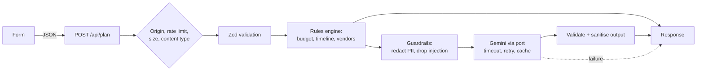

# Celebration Planner

A planning assistant for **weddings, birthdays and community events**. Answer six questions and get a budget split, a dated timeline, a vendor checklist and personalised ideas.

**Live demo:** https://YOUR-PROJECT.vercel.app &nbsp;|&nbsp; **Challenge:** Challenge 5, Celebration & Event Planner

## 1. Chosen vertical and persona

**Vertical:** Celebration & Event Planner.

**Persona:** a first-time organiser (a couple, a parent, or a community volunteer) with limited time and no event experience. They know the date and roughly what they can spend. They do not know how to split the money, when to book what, or what to ask vendors.

**Root challenge:** a generic chatbot gives the same advice to a 20-guest birthday and a 300-guest wedding, and cannot be relied on for arithmetic or dates. Planning is a decision problem first and a writing problem second, so this app makes the decisions with rules and uses AI only where creativity helps.

## 2. Approach and decision logic

A **hybrid design**. A deterministic rules engine (`src/domain/`) produces everything that must be correct and repeatable. Gemini only writes the personalised ideas, behind guardrails, and the app works fully if it is unavailable.

| Context                                            | Decision                                                                                       | Where                                    |
| -------------------------------------------------- | ---------------------------------------------------------------------------------------------- | ---------------------------------------- |
| Event type                                         | Different budget categories, task lists and vendors                                            | `budget.ts`, `timeline.ts`, `vendors.ts` |
| 150+ guests                                        | 4 points move from decor (or promotion) to catering (or equipment)                             | `budget.ts`                              |
| Under 30 days away                                 | 3 points move into contingency for rush fees                                                   | `budget.ts`                              |
| Budget per guest below a typical minimum           | Warning, scaled by currency                                                                    | `budget.ts`                              |
| Less time than the ideal schedule                  | Every lead time is scaled down; tasks that should already have started are flagged "Start now" | `timeline.ts`                            |
| Inside the minimum safe window (90 / 14 / 30 days) | Explicit warning                                                                               | `timeline.ts`                            |
| 150+ wedding guests, 100+ community guests         | Parking / first-aid vendors added                                                              | `vendors.ts`                             |

Every adjustment is explained in plain language in the result ("Large guest list (200): moved 4% from Decor to Catering"), and the page labels what is rule-based and what is AI-written, so users can calibrate their trust.

## 3. How it works



`POST /api/plan` returns `{ plan, ideas, aiStatus, aiNotices }`. `aiStatus` is `ok`, `disabled` (no key) or `unavailable` (Gemini failed); `plan` is always complete. Errors use stable codes (`invalid_input`, `rate_limited`, ...) and never include internal details.

## 4. How each evaluation criterion is addressed

| Criterion             | What was done                                                                                                                                                                                                                                                     | Evidence                                                          |
| --------------------- | ----------------------------------------------------------------------------------------------------------------------------------------------------------------------------------------------------------------------------------------------------------------- | ----------------------------------------------------------------- |
| **Code quality**      | Strict TypeScript (`noUncheckedIndexedAccess`), no `any`, ESLint + Prettier, layered `domain` / `ai` / `security` / `server` / `components`. The Gemini SDK sits behind small interfaces (dependency inversion). Comments explain why, not what.                  | `tsconfig.json`, `eslint.config.mjs`, `src/`                      |
| **Security**          | See section 5.                                                                                                                                                                                                                                                    | `src/security`, `src/proxy.ts`, `next.config.ts`                  |
| **Efficiency**        | Budget and dates are computed in code, not by the LLM. One Gemini call per plan with capped output, 10 s timeout, one retry, request cancellation on client disconnect, and a short result cache. No UI library, no web fonts, no client-side validation library. | `src/domain`, `src/ai/gemini.ts`, `src/ai/cache.ts`               |
| **Testing**           | Vitest state-based tests with injected fakes (no live network, no mock-call assertions) for the rules engine, guardrails, Gemini adapter, HTTP handler, rate limiters and an axe-core accessibility test. CI runs everything.                                     | `tests/`, `.github/workflows/ci.yml`                              |
| **Accessibility**     | Targets WCAG 2.2 AA: semantic HTML, skip link, labelled fields with hints and errors, focus moved to results or errors, pre-mounted status region, 44 px targets, AA contrast pairs, dark mode, reduced motion, forced colours, no inline styles.                 | `src/components`, `src/app/globals.css`, `tests/ui/a11y.test.tsx` |
| **Problem alignment** | Covers all three event types and all four asks (budget, timeline, vendor checklist, personalised ideas) with visible context-based decisions.                                                                                                                     | Section 2                                                         |

## 5. Security

Controls run in code, outside the model, because instructions inside a prompt cannot be relied on.

| OWASP LLM Top 10 (2025)        | Mitigation                                                                                                                                                    |
| ------------------------------ | ------------------------------------------------------------------------------------------------------------------------------------------------------------- |
| LLM01 Prompt injection         | User text is passed as JSON data labelled untrusted. Instruction-like text is dropped before the AI sees it and the user is told. Output must match a schema. |
| LLM02 Sensitive information    | Emails, phone and card numbers and API keys are redacted before text leaves the server. The UI warns not to enter personal details.                           |
| LLM05 Improper output handling | Output is validated with Zod, stripped of markup, rendered by React (escaped), and the page has a nonce-based CSP.                                            |
| LLM06 Excessive agency         | The model has no tools and takes no actions.                                                                                                                  |
| LLM07 System prompt leakage    | No secrets live in the prompt. A per-request canary is planted and any response containing it is rejected.                                                    |
| LLM10 Unbounded consumption    | Input length caps, 8 KB body limit, rate limiting, capped output tokens, timeout and a single retry.                                                          |

Web hardening: per-request CSP nonce (`src/proxy.ts`), HSTS, `X-Frame-Options`, `nosniff`, referrer and permissions policies (`next.config.ts`), same-origin check on the API, `Cache-Control: no-store`, generic error messages, strict request schema that rejects unknown fields, API key read only on the server, `.env` ignored, `npm audit` and a secret scan in CI, Dependabot.

## 6. Assumptions and limitations

- Budget amounts are whole numbers. The per-guest minimums and currency factors (USD, EUR, GBP, INR) are rough estimates, not market prices.
- Lead times are typical planning guidance, not vendor-specific availability.
- Dates are handled in UTC.
- Rate limiting is per server instance unless the optional Upstash variables are set; with them it is shared across instances and falls back to in-memory if Upstash is unreachable.
- The injection filter is a heuristic that can miss attacks. It is one layer among several, never the only one.
- Cached ideas are reused for five minutes for identical inputs, so an immediate re-submit returns the same ideas.
- English only. Text is UTF-8 and strings are kept out of logic, but there is no translation layer yet.
- Free-tier Gemini input may be used by Google to improve its products, so the app asks users not to enter personal details.

## 7. Run, test and deploy

```bash
npm install
cp .env.example .env.local   # add GEMINI_API_KEY (optional: the app works without it)
npm run dev                  # http://localhost:3000

npm run typecheck && npm run lint && npm test
npm run preflight            # submission gate: branch, size, secrets, checks
```

**Deploy to Vercel:** push to a public GitHub repository, import it at vercel.com/new (the Next.js preset is detected), add `GEMINI_API_KEY` (and optionally `GEMINI_MODEL`, `UPSTASH_REDIS_REST_URL`, `UPSTASH_REDIS_REST_TOKEN`) under Project Settings, Environment Variables, then deploy.

## 8. Project structure

```
src/domain/     pure rules engine: budget, timeline, vendors, validation schema
src/ai/         Gemini port, prompt, output schema, cache; only gemini-client.ts imports the SDK
src/security/   redaction, injection heuristic, output sanitiser, canary
src/server/     config, plan service, HTTP handler, rate limiters, composition root
src/components/ accessible form and results
src/app/        Next.js routes, layout, styles
src/proxy.ts    per-request CSP nonce
tests/          mirrors src/
scripts/        preflight.mjs
vercel.json     Vercel deployment configuration
```

MIT licensed.
